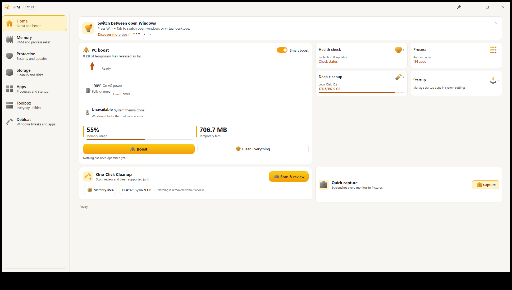
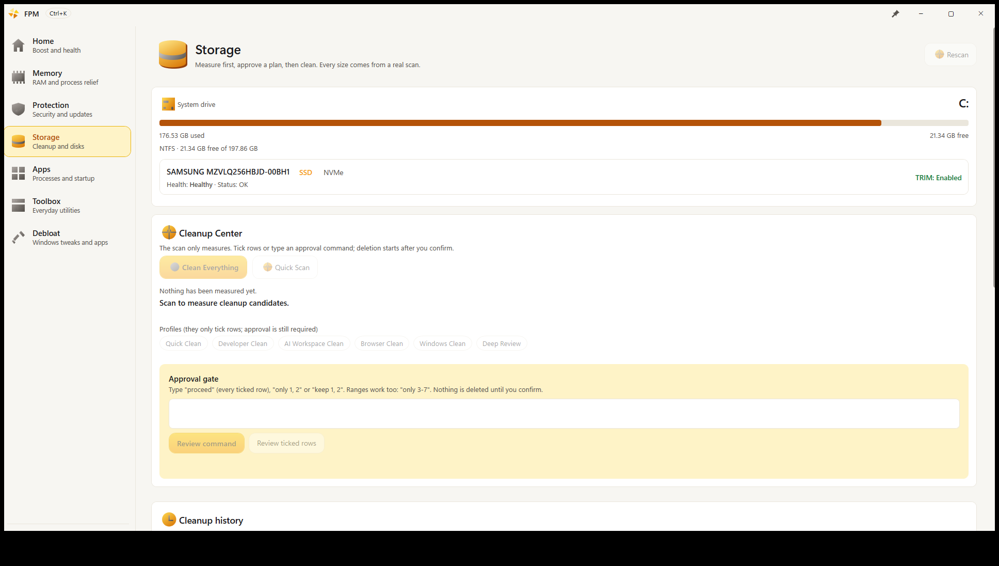
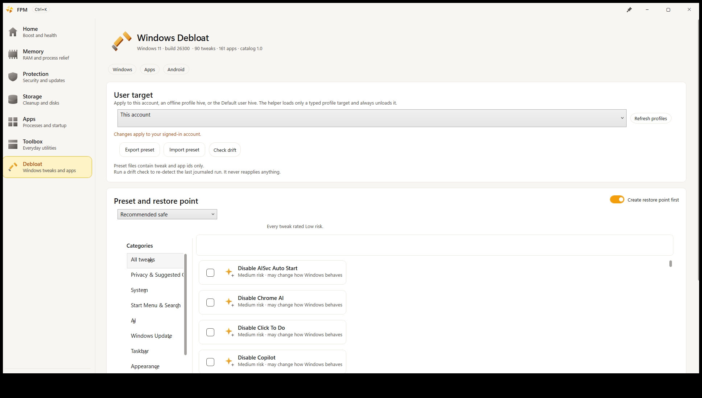
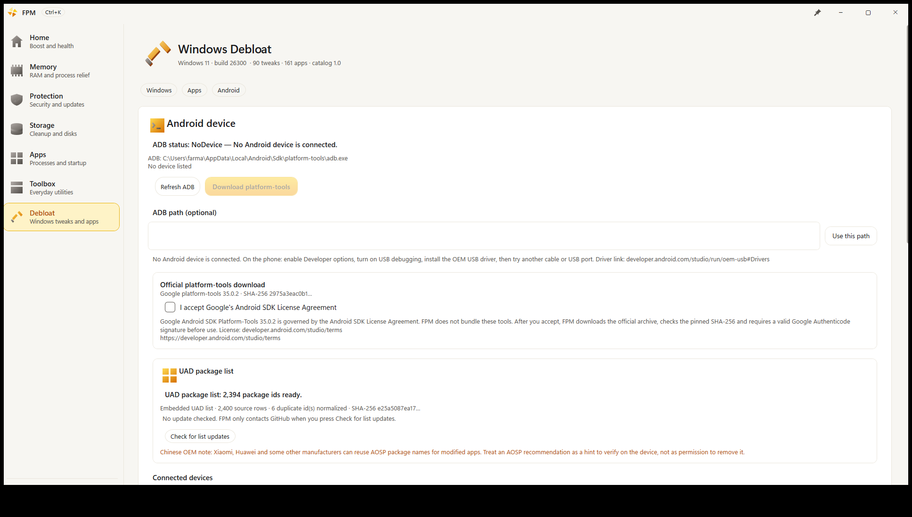

# <p align="center"></p>

# FPM

**A local-first Windows 10/11 PC manager for cleanup, memory, storage, protection and Android/Windows debloat.**

<p align="left">
  <a href="https://github.com/farmanullah1/FPM/releases"></a>
  <a href="https://github.com/farmanullah1/FPM"></a>
  <a href="LICENSE"></a>
  
  
  <a href="CONTRIBUTING.md"></a>
</p>

## What is FPM

FPM is a native C# / WPF application built around a **preview, approval, apply, verify, log and undo** safety model.
It uses real system measurements and keeps local state under `%LOCALAPPDATA%\FPM`.

- Cleanup and quarantine: storage and cache scans, cleanup profiles, duplicate detection, and measured before/after reports
- Memory: real physical, available and commit data plus graceful per-app memory relief
- Protection: Defender status, Windows Update status, network checks, pop-up scanning and hosts-block controls
- Apps and startup: process, Win32 and Store package views with confirmation before removal
- Windows debloat: typed, OS-gated catalog actions through the elevated helper with preview and undo
- Android debloat: signed ADB discovery, private-IP wireless pairing, typed package actions and snapshot/restore
- Toolbar and sensors: dockable toolbar, battery and thermal readings when the platform exposes them

FPM is not affiliated with, endorsed by, or supported by Microsoft or Google.

## Screenshots

Real application captures are stored in [`docs/images/`](docs/images/). Capture files are generated from the running app,
not drawn mockups.

| Home | Storage |
|---|---|
|  |  |

| Debloat — Windows | Debloat — Android |
|---|---|
|  |  |

Additional captures: [`memory-light.png`](docs/images/memory-light.png),
[`toolbar-docked.png`](docs/images/toolbar-docked.png), and [`home-dark.png`](docs/images/home-dark.png).
Some platforms or devices intentionally show **Unavailable** instead of a fabricated value.
The installer wizard and compact/mini mode have not yet been captured in a successful desktop
install, so they are not shown here as real screenshots.

## Download and install

The installer is R3 work in progress. Release artifacts, when produced:

- `FPM-Setup-x.y.z.exe` — x64 Inno Setup installer
- `FPM-portable-x.y.z.zip` — portable build containing `portable.flag`
- `SHA256SUMS.txt` — SHA-256 checksums

```powershell
FPM-Setup-x.y.z.exe /VERYSILENT /SUPPRESSMSGBOXES /NORESTART
FPM-Setup-x.y.z.exe /VERYSILENT /TASKS="desktopicon"
```

The installer and uninstall behavior are still being verified. Unsigned local builds may trigger
SmartScreen. Do not install or run unverified artifacts from a third party.

## Safety model

1. **Scan** is read-only.
2. **Review** shows the exact typed change and risk.
3. **Approve** is explicit and destructive confirmations stay modal.
4. **Apply** uses closed helper commands and validates every id/path.
5. **Verify** re-reads state.
6. **Log** records the result; snapshots or reinstall guidance support undo.

FPM does not delete Microsoft PC Manager files, protected Windows processes or Android
denylisted packages silently. Android package removal requires the user to acknowledge the
warning and Unsafe packages require Expert mode plus exact package confirmation.

## Build from source

```powershell
git clone https://github.com/farmanullah1/FPM.git
cd FPM
dotnet restore app/PCManager.sln
dotnet build app/PCManager.sln -nodeReuse:false -m:1 --no-restore
dotnet test app/tests/PCManager.Tests/PCManager.Tests.csproj --no-build -nodeReuse:false
dotnet run --project app/src/PCManager/PCManager.csproj
```

Release packaging:

```powershell
powershell -NoProfile -ExecutionPolicy Bypass -File tools/build-release.ps1
```

## Project structure

```text
app/src/Core/       typed models and platform-independent logic
app/src/Services/   system, cleanup, Android and sensor services
app/src/ViewModels/ page and shell MVVM
app/src/PCManager/  WPF shell and XAML
app/src/Helper/     requireAdministrator typed helper
app/tests/          xUnit safety and behavior tests
tools/              lint, contrast, icon generation and UI probes
docs/readiness/     card plan and verified progress
installer/          Inno Setup script
```

## Privacy

FPM has no telemetry and no account requirement. Settings, logs, snapshots and cleanup evidence
stay under `%LOCALAPPDATA%\FPM`. Android action logs hash the device serial rather than storing
the raw serial.

## Windows and Android debloat

Windows debloat is a typed catalog port of Win11Debloat behavior, not an executed copy of the
PowerShell script. Every action has detect/apply/revert behavior where the underlying Windows
state is journalable.

Android debloat uses a typed UAD package catalog and ADB command surface. Enable USB debugging
on the phone, unlock it and accept the USB authorization prompt. FPM can offer the official
Google platform-tools download, but it never downloads or uses a tool until the Android SDK
license is accepted and the archive and `adb.exe` pass checksum/signature checks.

## Troubleshooting

- **SmartScreen:** verify the SHA-256 checksum and use a signed installer when available.
- **ADB missing:** set an adb path or accept the pinned Google platform-tools download.
- **No sensor value:** FPM reports `Unavailable` with a reason; no live reading is invented.
- **UAC prompt:** decline or close it to leave the operation unchanged.
- **Portable mode:** release packaging includes `portable.flag`; user data and settings still
  follow the app's documented per-user data folder unless the implementation says otherwise.

## Contributing

See [`CONTRIBUTING.md`](CONTRIBUTING.md). Reports and fixes should preserve the safety rules,
include focused tests and provide fresh build/test evidence.

## License and attribution

FPM is licensed **GPL-3.0-or-later**. Win11Debloat attribution and the Universal Android
Debloater GPL reference are documented in [`THIRD_PARTY_NOTICES.md`](THIRD_PARTY_NOTICES.md).

All FPM branding and artwork are original. No Microsoft or Google code, icons or branding are
redistributed. Windows and Microsoft PC Manager are trademarks of Microsoft Corporation.
Android is a trademark of Google LLC.
